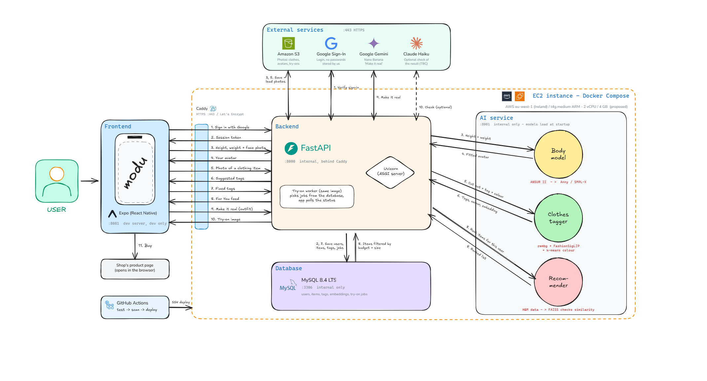

# Modu


**A virtual wardrobe and shopping app: scan your clothes, discover real items from Irish and UK shops, try outfits on your own avatar, and buy in one tap.**

DkIT Collaborative Project 2026/27       5-person team

---

## Table of Contents

- [Overview](#overview)
- [Core Loop](#core-loop)
- [System Architecture](#system-architecture)
- [AI](#ai)
- [Catalogue](#catalogue)
- [Tech Stack](#tech-stack)
- [Repository Structure](#repository-structure)
- [Getting Started](#getting-started)
- [Testing and Quality](#testing-and-quality)
- [Contributors](#contributors)
- [Resources](#resources)

---

## Overview

Modu connects the clothes you already own with the clothes you might buy. You scan your wardrobe, the app learns your style, shows you real items from Irish and UK shops, and lets you see them on an avatar built from your own measurements before you spend anything.

**Target users (to be confirmed):** 

### Key Highlights

- **Try it on you:** mix your own clothes and saved items on an avatar fitted to your body
- **Your closet, styled:** recommendations built around what you already own
- **Our own models:** body, tagging and recommender models trained and evaluated by the team, not an API wrapper
- **Measured decisions:** every tech choice is backed by a comparison of accuracy, cost and time
- **Enforced security:** ownership tests on every route, CI from day one

---

## Core Loop

The scope is kept narrow on purpose:

1. **Scan your clothes.** Take a photo; Will be stored as personal item.
2. **For You feed.** Real items from Irish and UK shops. Save the ones you like.
3. **Try on.** Mix your own and saved clothes on your avatar. **"Make it real"** turns the outfit into a photoreal image.
4. **Buy.** A link opens the shop's product page.

---

## System Architecture



The app talks to one server on AWS (an EC2 instance in Ireland) over HTTPS. On the server everything runs in Docker containers with Docker Compose:

- **Caddy** is the front door and the only public part (port 443). It handles HTTPS and passes requests to the backend.
- **Backend (FastAPI + Uvicorn)** checks who the user is and that they own what they ask for, then talks to the database, storage and AI.
- **Worker** runs the slow "Make it real" jobs in the background so the app never waits. The app polls the job status.
- **AI service** runs our own models: body model, clothes tagger and recommender, plus FAISS for similar items.
- **MySQL** stores users, items, tags, embeddings and try-on jobs.

Outside the server: **Amazon S3** for photos (the database only keeps the path), **Google Sign-In** for login, **Google Gemini (Nano Banana)** for the photoreal try-on, and an optional result check with Claude Haiku (TBC). **GitHub Actions** tests, scans and deploys every change.

**Request flow:** app → Caddy → Uvicorn → FastAPI route → MySQL, S3 or AI if needed → JSON back → Caddy → app

Full details, ports, hosting costs and the reasons behind each choice are in [docs/facts.md](docs/facts.md). The diagram can be edited in [Excalidraw](https://excalidraw.com/#json=emM27aCyYjIGitOruHnrZ,k6bvx05Aj-GLQ9x1Xdf1zA).

---

## AI

| Model | What it does | Owner |
| --- | --- | --- |
| **Body** | The user types height and weight; a model trained on ANSUR II predicts the remaining measurements, and an Anny (or SMPL-X) body is fitted. The clad-body library (Apache 2.0) can be used here. 
| **Clothes tagging** | Background removal, FashionSigLIP / FashionCLIP tags, k-means colour. User corrections are saved as training data. Test set: a 200-photo closet shot by the team. 
| **Recommender** | Several strategies (closet, similar items, people like you, boards) plus a reranker by price range. Trained on the H&M Kaggle dataset. Hard filters (budget, size) run on the server before ranking. 
| **Try-on** | Free 2D preview on the avatar. "Make it real" uses Nano Banana (the only paid API, about $0.04 per image). 


---

## Catalogue

**No scraping.** Items come from:

- **H&M Kaggle dataset:** demo and training
- **Affiliate feeds:** Awin (M&S, River Island, Nike), Rakuten (Mango), Vestiaire Collective for second-hand | TBC
- **Share-from-app:** the user shares an item from the H&M or Vinted app into Modu | TBC
- **Local shops** that give us permission | TBC 


---

## Tech Stack

Proposed stack, see [docs/facts.md](docs/facts.md) for the reasons and costs.

| App | API | Data | AI | DevOps |
| --- | --- | --- | --- | --- |
| Expo (React Native), PWA option<br/>Expo SecureStore for tokens<br/>Google Sign-In | FastAPI + Uvicorn (Python)<br/>One router per feature<br/>Alembic migrations<br/>Background worker for try-on jobs | MySQL 8.4<br/>Amazon S3 for photos | ANSUR II body model, Anny / SMPL-X<br/>rembg + FashionSigLIP / FashionCLIP<br/>H&M recommender + FAISS<br/>Nano Banana | AWS EC2 + Docker Compose<br/>Caddy (HTTPS)<br/>GitHub Actions CI/CD + security scans<br/>Protected `main`, PR reviews |

---

## Repository Structure

```
Modu/
├── .github/    Pull request template (CI workflows go here too)
├── ai/         Our models: notebooks, training, evaluation, inference
├── backend/    FastAPI server: auth, business logic, background jobs
├── database/   MySQL: schema, migrations, seed data
├── docs/       Architecture, decisions, Scrum, design and testing docs
└── frontend/   Phone app (Expo / React Native)
```

Each folder will get its own `README.md` with setup steps once work on that component starts.

---

## Getting Started

### Prerequisites

- Git
- Node.js LTS (app)
- Python 3.11+ (api, ml)
- Docker Desktop (running the full stack)


---

## Testing and Quality

- **Automated tests and CI from the start.** Tests run on every pull request.
- **Ownership tests:** every API route has a test proving a user cannot read or change another user's data.
- **AI evaluation:** each model is measured on accuracy, cost and time, with results kept in the repo.
- Every pull request explains **how to test it** before it can be reviewed.
- Bugs are reported with the **Bug report** issue template.

---

## Contributors

| Name | Role | GitHub |
| --- | --- | --- |
| Sofia | Product Owner, Lead UI/UX Designer, Frontend, Scrum | [@vialsiu](https://github.com/vialsiu) |
| Harris | Lead Security, Backend, AI | [@harrist03](https://github.com/harrist03) |
| Iker Arza | Cloud and Deployment, CI/CD, Backend, System Architecture, Software Testing | [@hypzx2105](https://github.com/hypzx2105) |
| Favour | Lead Frontend Developer, Software Testing, UX Testing, Research | [@f4eriebambi](https://github.com/f4eriebambi) |
| Cheryl | Lead Database, Backend, AI | [@hcheryl](https://github.com/cheryl7114) |

---

## Resources

|  Portfolio (Mahara) |  Figma |  Screencast |  Scrumwise |
| --- | --- | --- | --- |
| TODO | TODO | TODO | TODO |

---


## Acknowledgments

- Dundalk Institute of Technology for project support
- ANSUR II, the H&M Personalized Fashion Recommendations dataset, and the clad-body library (Apache 2.0)
